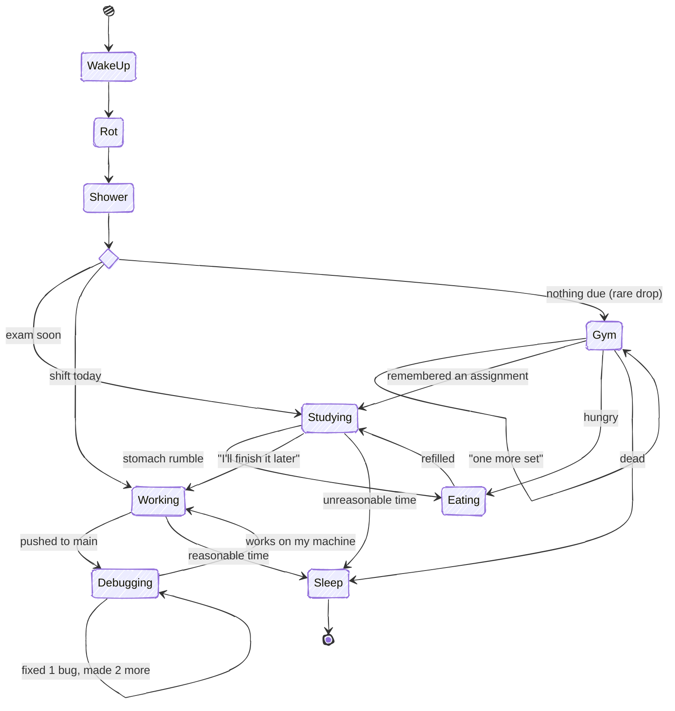

### 👋 Welcome to My GitHub!

Hi, I'm Justin. This is where I share projects I've built — mainly from school and some personal work.

#### 📂 What's Here:
- Projects developed for coursework and labs
- Personal projects
- Forked versions of my work with others (for easier access)

*Everything here reflects what I've worked on directly.*

##### 🌐 Portfolio

You can also check out my portfolio (still a work in progress): [justinelchibani.dev](https://justinelchibani.dev/)

### me:

PS. I just found out I could make mermaid diagrams look handdrawn (Thank you Claude). ngl am proud of the accurace of my state machine
